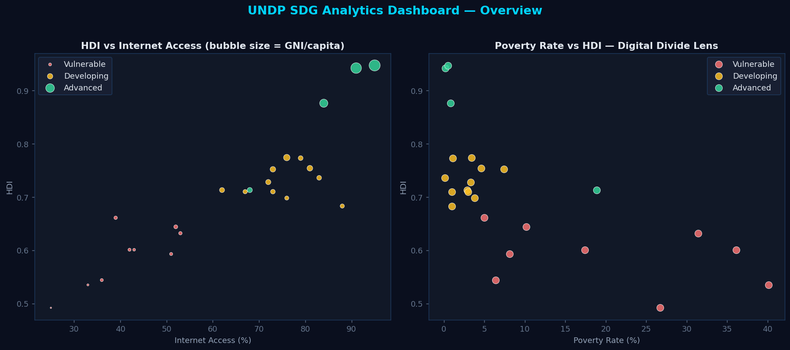
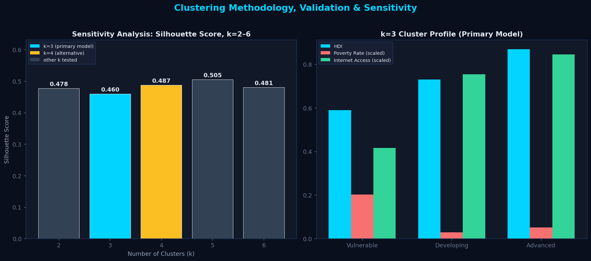

# 🌍 UNDP SDG Analytics Dashboard

An interactive data science dashboard analyzing UN Sustainable Development
Goal (SDG) indicators across 24 countries and 6 regions — built while
preparing for the UNDP Digital, AI and Innovation Hub Internship.



## 🔍 What It Does

- **K-Means Clustering** — groups countries into *Vulnerable / Developing /
  Advanced* tiers based on HDI, poverty rate, internet access, and CO₂ per
  capita
- **Elbow Method + Silhouette Score** — statistically evaluates candidate
  values of k rather than picking one arbitrarily
- **Sensitivity Analysis (k=2–6)** — compares k=3 against every other
  reasonable choice on silhouette score, including k=4 as a documented
  alternative, instead of asserting k=3 is automatically optimal
- **Missing Data Handling** — the raw dataset includes realistic missing
  values; cleaning uses regional median imputation, with the before/after
  shown transparently in the app
- **Gini Coefficient** — quantifies income inequality across GNI per capita
- **HDI Trend Analysis (2015–2023)** — time-series view capturing the
  COVID-19 regression visible in several countries' HDI scores



## 📊 Data Sources

| Indicator | Source |
|---|---|
| Human Development Index (HDI) | [UNDP Human Development Report 2023](https://hdr.undp.org/data-center) |
| Poverty rate, literacy, internet access, GNI/capita | [World Bank World Development Indicators](https://databank.worldbank.org/source/world-development-indicators) |
| CO₂ per capita | [Our World in Data](https://ourworldindata.org/co2-emissions) |

Countries were manually curated across 6 regions (Sub-Saharan Africa, South
Asia, Latin America, Europe, East Asia & Pacific, MENA) to ensure geographic
diversity rather than selecting only data-complete or high-income nations.

## 🛠️ Tech Stack

- **Python** — core language
- **Pandas / NumPy** — data loading, cleaning, transformation
- **scikit-learn** — K-Means clustering, MinMax scaling, silhouette scoring
- **Plotly** — interactive charts (scatter, line, bar)
- **Streamlit** — dashboard framework

## 🧹 Data Cleaning Approach

Real SDG data is rarely complete. `data/sdg_indicators_raw.csv` intentionally
includes missing values (as World Bank/UNDP exports often do) to demonstrate
the cleaning pipeline in `app.py`:

1. Missing numeric values are imputed using the **median of other countries
   in the same region** — not a global median — since development indicators
   correlate strongly within a region.
2. If an entire region's values are missing for a column, a global median
   fallback is used.
3. The "Data Cleaning" tab in the app shows the missing-value report and a
   before/after comparison so the imputation is auditable, not hidden.

## 🔵 Why k=3 for Clustering — and Why Not k=4

`k=3` is used as the **primary model** throughout this dashboard, but it is
not the only value tested, and it is not automatically the "best" one by
the numbers alone. The app includes a full **Sensitivity Analysis (k=2–6)**
tab that runs K-Means across that whole range and reports silhouette scores
honestly:

| k | Silhouette Score |
|---|---|
| 2 | 0.478 |
| **3** | **0.460** |
| 4 | 0.487 |
| 5 | 0.505 (highest) |
| 6 | 0.481 |

**k=3 does not have the highest silhouette score in this dataset — k=5 does.**
That's stated plainly in the app rather than hidden, because pretending the
chosen k was automatically optimal would misrepresent what the statistics
actually show.

**So why keep k=3 as the primary model?**
- It maps directly onto UNDP's own Low / Medium / High human development
  framework, which makes the clusters interpretable for policy discussion —
  a property no purely statistical metric captures.
- The silhouette differences across k=2 to k=6 are small (0.46–0.51), so no
  single k is decisively "correct" on separation quality alone. In that
  regime, interpretability is a reasonable tiebreaker.
- At k=4 specifically, the dashboard shows a country-by-country comparison:
  the extra cluster **splits the existing *Vulnerable* group into two
  sub-groups**, while *Developing* and *Advanced* stay intact. k=4 adds
  resolution at the low-HDI end rather than telling a different story — it's
  documented in the app as a legitimate alternative, not dismissed.

All four clustering features (HDI, poverty rate, internet access, CO₂ per
capita) are **Min-Max normalized to [0,1] before clustering** — without this,
GNI-scale features would dominate the Euclidean distance calculation purely
due to unit scale, not real similarity. (GNI itself is excluded from the
clustering features to avoid the clusters simply re-deriving income
brackets — it's examined separately via the Gini coefficient instead.)

All four clustering features (HDI, poverty rate, internet access, CO₂ per
capita) are **Min-Max normalized to [0,1] before clustering** — without this,
GNI-scale features would dominate the Euclidean distance calculation purely
due to unit scale, not real similarity.

## 🎯 SDGs Covered

- **SDG 1** — No Poverty
- **SDG 4** — Quality Education (literacy)
- **SDG 9** — Industry, Innovation & Infrastructure (internet access)
- **SDG 10** — Reduced Inequalities (Gini coefficient)

## 🚀 Running Locally

```bash
git clone https://github.com/<your-username>/UNDP-SDG-Analytics-Dashboard.git
cd UNDP-SDG-Analytics-Dashboard
pip install -r requirements.txt
streamlit run app.py
```

The app will open at `http://localhost:8501`.

## 📁 Project Structure

```
UNDP-SDG-Analytics-Dashboard/
│
├── app.py                        # Streamlit app: cleaning, clustering, visualization
├── utils/
│   ├── data_loader.py            # Data ingestion, validation, cleaning pipeline
│   ├── clustering.py             # K-Means, Gini coefficient, elbow method — from scratch
│   └── charts.py                 # Plotly chart-building functions
├── notebooks/
│   └── EDA.ipynb                 # Exploratory data analysis walkthrough
├── data/
│   ├── sdg_indicators_raw.csv    # Raw data with realistic missing values
│   ├── sdg_indicators.csv        # Reference clean dataset
│   ├── hdi_trends.csv            # 2015–2023 HDI time series
│   └── data_sources.md           # Column-level source documentation
├── requirements.txt
├── README.md
└── screenshots/
    ├── dashboard.png
    └── analysis.png
```

`app.py` contains a self-contained version of the pipeline for the live
Streamlit dashboard. `utils/` holds the same logic as reusable, testable
modules (including a from-scratch K-Means implementation), and
`notebooks/EDA.ipynb` walks through the analysis step by step — useful for
showing your reasoning in an interview.

## Development Approach

This project was built with AI-assisted development (Claude, Anthropic) for
code scaffolding. My own contributions: problem framing and SDG indicator
selection, data source research, methodology decisions (clustering features,
k selection, imputation strategy), and the analysis and policy interpretation
throughout. AI-assisted development is standard practice in modern data
science workflows, and this project reflects that approach while keeping the
methodology fully explainable and defensible.

## 📄 License

MIT — feel free to fork and extend with more countries or indicators.
